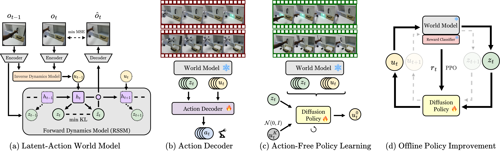

Toyota Motor Europe NV/SA and its affiliates retain all intellectual property and proprietary rights in and to this software, related documentation and any modifications thereto. Any use, reproduction, disclosure or distribution of this software and related documentation without an express license agreement from Toyota Motor Europe NV/SA is strictly prohibited.

---
# DiWALI: Diffusion Policy Learning in World Models via Latent Action Inference from Human and Robot Play

[](https://arxiv.org/abs/2611.24836)
[](https://diwali.cs.uni-freiburg.de)
[](https://github.com/robot-learning-freiburg/diwali/blob/main/LICENSE)
[](https://www.pytorch.org)

<center>
<div align="center">&nbsp;<table><tr><td>
    <div align="center">
    <strong>
        <a href="https://arxiv.org/abs/2611.24836">
            DiWALI: Diffusion Policy Learning in World Models via </br>Latent Action Inference from Human and Robot Play
        </a><br/>
    </strong>
    <a href="https://akshaychandra.com/">Akshay L Chandra</a><sup>1</sup>, <a href="https://imanema.com/">Iman Nematollahi</a><sup>1</sup>, <a href="">Lingyue Zhao</a><sup>3</sup>, <a href="">Daria Kulikova</a><sup>1</sup>, <br><a href="">Angela P. Schoellig</a><sup>4</sup>,<a href="">Fabien Despinoy</a><sup>2</sup>, <a href="https://rl.uni-freiburg.de/people/valada">Abhinav Valada</a><sup>1</sup><br>
    <sup>1</sup><em>Univeristy of Freiburg</em> &nbsp;&nbsp;&nbsp;&nbsp; <sup>2</sup><em>Toyota Motor Europe</em>  &nbsp;&nbsp;&nbsp;&nbsp;  <sup>3</sup><em>Technical University of Munich</em><br>
</td></tr></table>&nbsp;
</center>



## 💻 Installation
1. To begin, clone this repository locally
```bash
git clone --recurse-submodules https://github.com/robot-learning-freiburg/diwali.git
cd diwali
```

2. Set environment variables for datasets and logging directory (default is `dataset/` and `logs/`), and set WandB entity (username or team name)
```bash
source scripts/set_path.sh
```

3. ⚠️ If you've already cloned the repo without `--recurse-submodules`, run:
```bash
git submodule update --init --recursive
```

- **Submodule:** `calvin_env`

    This repository inclues `https://github.com/acl21/calvin_env/` as a submodule for simulation experiments, tracking its `lemon` branch. 

4. Create and activate the conda environment, then install the dependencies:

```bash
cd DIWALI_ROOT_DIR
uv venv --python 3.10
source .venv/bin/activate
sh install.sh 
```

## 🛠️ Usage
### 0. Dataset
To download and preprocess datasets for DiWALI, please follow A.0 and A.1 [here](dataset/README.md#a-calvin). In total, you would need the following datasets:
- task_D_D_64 (CALVIN data at `64x64` resolution)
- task_D_D_arm_64 (ARM data at `64x64` resolution)
- (optional) task_D_D_pd (Point dispalcements computed for CALVIN)
- (optional) task_D_D_arm_pd (Point displacements computed for ARM)
- task_D_D_ac5 (Action chunks)

### 1. World Model

#### 1.1 Training
```bash
python scripts/train_wm.py trainer.devices=[<GPU-ID>]
```
#### 1.2 Featurizer
```bash
python scripts/featurizer.py device=<GPU-ID>
```
#### 1.3 (Optional) Qualitative Test
Optionally, one can visually assess the quality of the learned world model with our test script.
```bash
python scripts/tests/visionwm.py
```

### 2. Diffusion Policy Training

**Note**: Before pre-training, please extract the featurized expert data with A.2 [here](dataset/README.md#a2-extract-expert-data-for-diffusion-policy-training) or you can download [here](https://diwali.cs.uni-freiburg.de/download/data/expert.zip).

All configs relevant for pre-training can be found under `config/<env>/pretrain/<skill-name>`. To pretrain CALVIN's `close_drawer` skill with 50 human arm episodes and 5 franka episodes, run:
```bash
python scripts/run.py \
  --config-name=pre_diffusion_mlp_feat_vision_arm_franka \
  --config-dir=config/calvin/pretrain/ \
  wm_ckpt_path="$PWD/dataset/wm/diwali/900000.ckpt" \
  action_decoder_path="$PWD/dataset/wm/diwali/action_decoder.ckpt" \
  env_name=close_drawer arm_dataset_name=feat-900k-arm-50 \
  dataset_name=feat-900k-franka-5 comment="diwali-test" seed=42

```

### 3. Reward Estimation
Before training the reward classifier, please generate the class-balanced classification data with A.3 [here](dataset/README.md#a3-generate-class-balanced-data-for-reward-classifier-training) or you can download pretrained reward classifiers [here](https://diwali.cs.uni-freiburg.de/download/ckpts/rewcls.zip).
```bash
python scripts/rewcls/train_contrastive.py
```

### 4. Fine-tuning inside World Model
All configs relevant for fine-tuning can be found under `config/<env>/finetune/<skill-name>`. Set `base_policy_path` to the relevant pretrained policy checkpoint. To fine-tune CALVIN's `close_drawer` skill, run:
```bash
python scripts/run.py --config-name=ft_mb_ppo_diffusion_mlp_feat_vision --config-dir=cfg/calvin/finetune/close_drawer device="cuda:0" train.bc_loss_coeff=0.025 train.use_bc_loss=True seed=42
```

## 📝 Citation
If you find DiWA useful in your work, please leave a ⭐ and consider citing our work with:
```
@article{chandra2026diwali,
  title   = {DiWALI: Diffusion Policy Learning in World Models via Latent Action Inference from Human and Robot Play},
  author  = {Chandra, Akshay L and Nematollahi, Iman and Zhao, Lingyue and Kulikova, Daria and Schoellig, Angela P. and Despinoy, Fabien and Valada, Abhinav},
  journal = {Under Review},
  year    = 2026
}
```

## 🏷️ License
This work is released under CC BY-NC-SA 4.0 license. See [LICENSE](LICENSE).


## ✨ Acknowledgement
* [DiWA, Chandra et al.](https://github.com/acl21/diwa): Base code
* [LUMOS, Nematollahi et al.](https://github.com/nematoli/lumos): World model training.
* [CALVIN, Mees et al.](https://github.com/mees/calvin_env): Simulation experiments.
